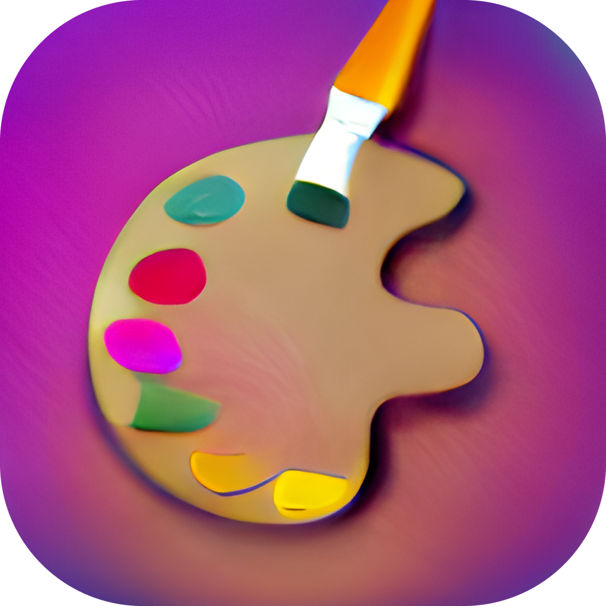

# Images: DALL·E Mega + Stable Diffusion 1.5, locally



Two 2022 text-to-image models running on your own NVIDIA GPU under Windows, with a desktop app, a
command line and a full-screen "screensaver" that paints the world outside as it is right now.

- **DALL·E Mega** ([dalle-mini/dalle-mega](https://huggingface.co/dalle-mini/dalle-mega)) via
  [min-dalle](https://github.com/kuprel/min-dalle), a PyTorch port of the same weights: square,
  256 × 256, with its own primitive look. (The original JAX/Flax code can't use the GPU on native Windows.)
- **Stable Diffusion 1.5** ([stable-diffusion-v1-5](https://huggingface.co/stable-diffusion-v1-5/stable-diffusion-v1-5))
  via [diffusers](https://github.com/huggingface/diffusers), fp16: any shape, 512 px on the short side,
  negative prompts, img2img.

## What's in it

- **Desktop app**, "Images" (`app.pyw`, PySide6): prompt, model, shape, batch size, seed, sampler, live preview,
  AI upscaling (Real-ESRGAN) up to 2048 px, a strip of this session's batches. Every image is saved as PNG
  with its prompt and settings in the metadata.
- **Image screensaver** (`screensaver.pyw`): a slow full-screen slideshow of images made on the spot from
  real things: the weather and time of day where you are, random words turned into a scene by a small
  local LLM, current headlines (as allegories) and "on this day" anniversaries. Night looks like night,
  images with stray text are redrawn, names of people and organisations are kept out of the prompts.
  Every image is saved with a JSON sidecar describing where it came from.
- **Image Movie** (`moviemaker.py`): a folder of screensaver images as an MP4, with dissolves, a slow
  zoom, and the weather and time as the screensaver shows them.
- **Command line** (`generate.py`): one-off or interactive generation with all the app's options.

## Quick start

```bash
uv sync                               # Python 3.12 + CUDA PyTorch and the rest
uv run download_weights.py --all      # ≈ 8 GB of weights into pretrained/
uv run make_shortcuts.py              # shortcuts: Images, Image Screensaver, Screensaver Settings, Image Movie
uv run generate.py "a watercolor painting of a lighthouse at dusk" --open
```

- **[Setup guide](docs/SETUP.md)**: requirements, installing, Ollama and ffmpeg, what goes online,
  troubleshooting.
- **[Manual](docs/MANUAL.md)**: the app, the screensaver and its keys, saved files, the day movie, every
  command-line option, speed and memory use.

## Licenses

The code in this repository is under the [MIT License](LICENSE).

The model weights are not included; `download_weights.py` fetches them from their publishers, and each
comes with its own license:

| Model | Used for | License |
|---|---|---|
| [DALL·E Mega](https://huggingface.co/dalle-mini/dalle-mega) | images | Apache 2.0 |
| [Stable Diffusion 1.5](https://huggingface.co/stable-diffusion-v1-5/stable-diffusion-v1-5) | images | [CreativeML OpenRAIL-M](https://huggingface.co/spaces/CompVis/stable-diffusion-license) (free use, with restrictions on harmful uses) |
| [Real-ESRGAN x4plus](https://github.com/xinntao/Real-ESRGAN) | upscaling | BSD 3-Clause |
| [dslim/distilbert-NER](https://huggingface.co/dslim/distilbert-NER) | keeping names out of prompts | Apache 2.0 |
| [Qwen3.5 2B](https://ollama.com/library/qwen3.5) via Ollama (optional) | scenes from words, image checks | Apache 2.0 |

Check those licenses before you use the images commercially.
